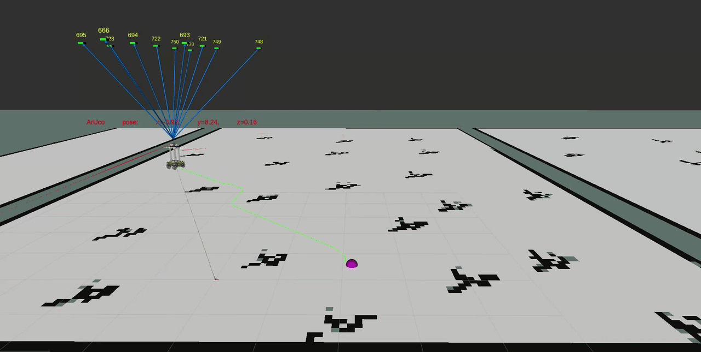
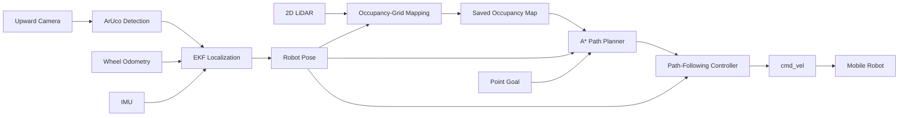
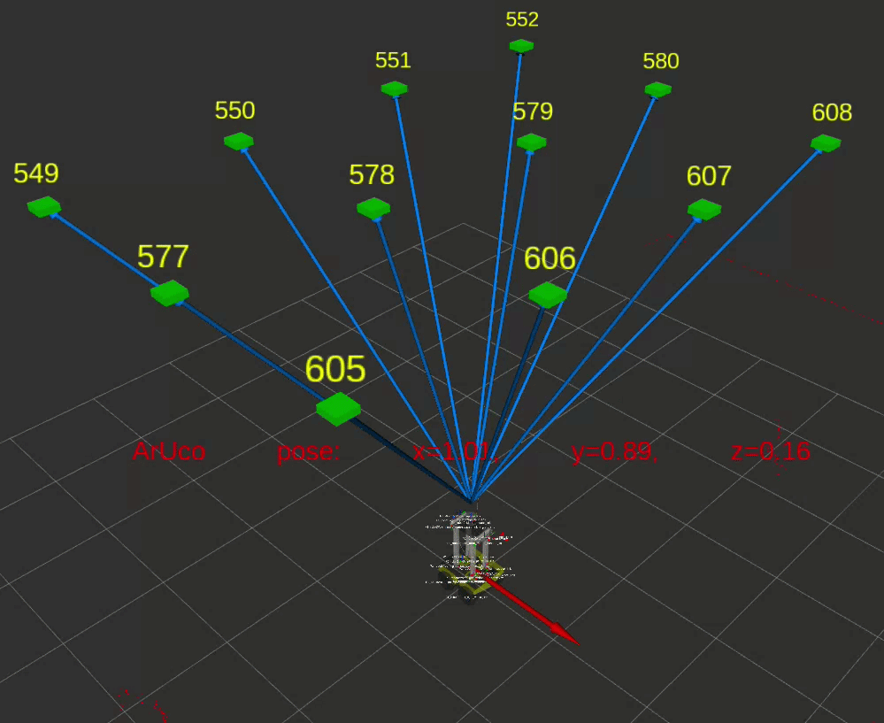
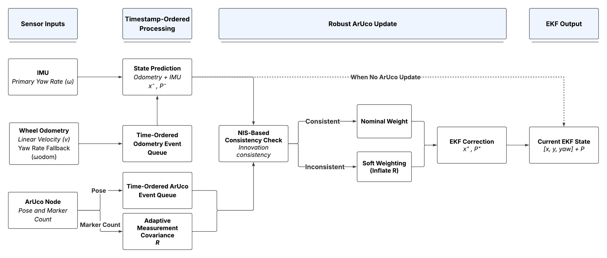
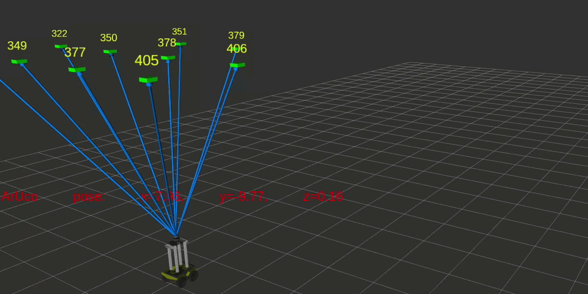
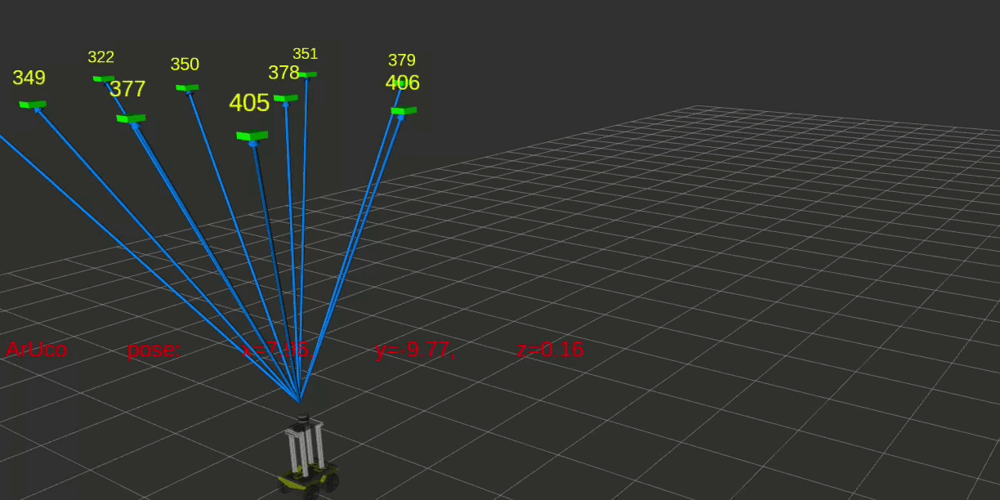
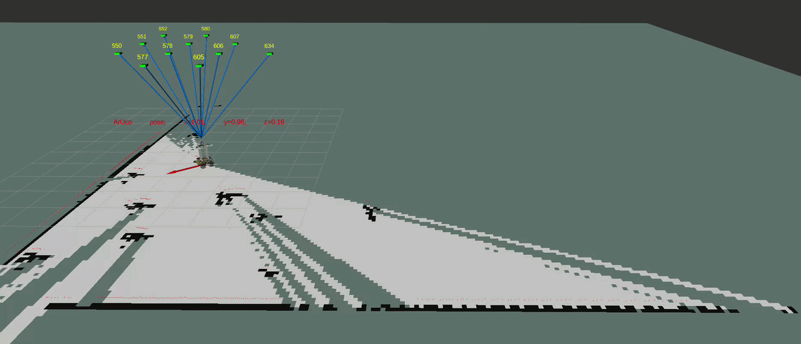
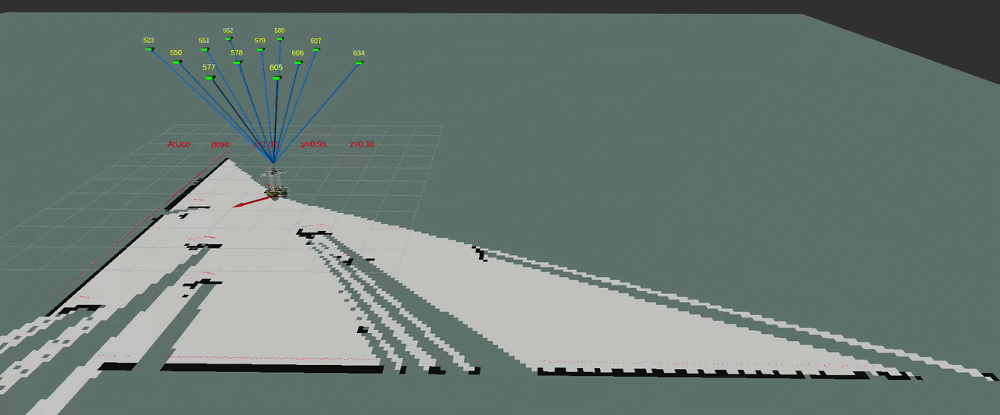
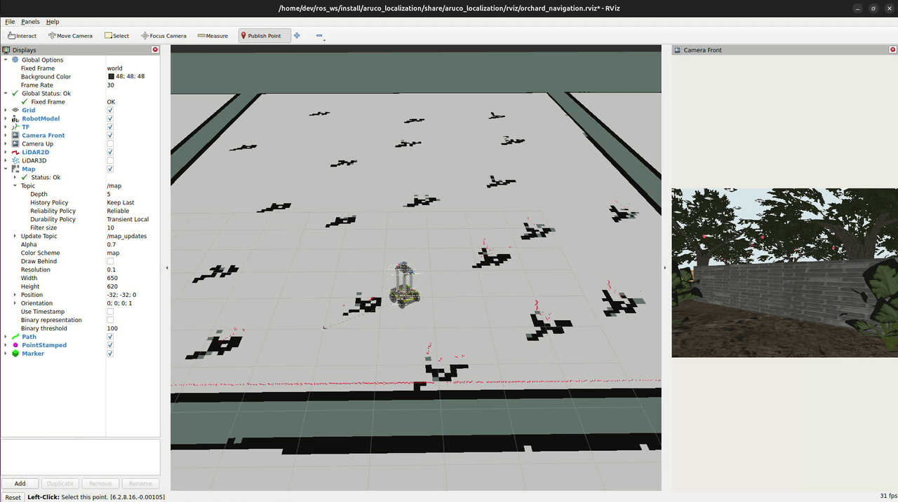

# Autonomous Orchard Robot

ROS 2 localization, mapping, path planning and autonomous navigation for a simulated agricultural orchard environment.

<p align="center">
  
</p>

<p align="center">
  <i>
    Sequential point-goal navigation using EKF localization,
    occupancy-grid path planning and closed-loop motion control.
  </i>
</p>

<p align="center">
  <strong>ROS 2 Jazzy · Python · EKF · LiDAR · ArUco · A* · Gazebo</strong>
</p>

---

## Key Results

| Component | Result |
| --- | ---: |
| EKF regression tests | **33 / 33 passed** |
| Planner regression tests | **12 / 12 passed** |
| Autonomous navigation trials | **3 / 3 goals reached** |
| Visual-map F1 @ 10 cm tolerance | **0.9409** |
| Collision-map F1 @ 10 cm tolerance | **0.9530** |
| EKF output rate | **~50 Hz** |

The current system has been validated in simulation using repeatable regression tests, recorded ROS 2 datasets and end-to-end navigation trials.

---

## What This Project Does

The project implements a complete 2D localization-to-navigation pipeline for a mobile robot operating in a structured orchard environment.

The system combines:

- wheel odometry and IMU measurements for local motion estimation,
- ArUco landmarks for absolute global pose observations,
- an Extended Kalman Filter for sensor fusion,
- LiDAR-based occupancy-grid mapping,
- grid-based path planning with obstacle inflation,
- waypoint-based closed-loop motion control,
- quantitative regression and map-quality evaluation.

The work was developed as part of the **Mobile Sensing and Robotics** master's program at the University of Bonn.

---

## System Architecture



Ground-truth odometry is used only for evaluation and diagnostics and is not part of the localization estimate.

---

## Localization and Sensor Fusion

Absolute localization is obtained from ceiling-mounted ArUco landmarks observed by an upward-facing camera.

<p align="center">
  
</p>

The global measurements are fused with wheel odometry and IMU information using a custom three-state Extended Kalman Filter:

```text
state = [x, y, yaw]
```

The localization pipeline includes:

- timestamp-ordered measurement processing,
- wheel-odometry prediction,
- timestamp-aware IMU association,
- marker-count-dependent measurement uncertainty,
- NIS-based consistency checking,
- adaptive measurement weighting,
- Joseph-form covariance updates,
- bounded persistent-recovery logic.

<p align="center">
  
</p>

The implementation was designed around asynchronous ROS 2 sensor streams rather than assuming perfectly synchronized callback execution.

---

## Robustness to Localization Disturbances

Localization behavior was also evaluated under abrupt pose disagreement.

| Raw ArUco localization | EKF response |
| --- | --- |
|  |  |

The filter uses innovation consistency and persistent recovery logic to distinguish transient disagreement from sustained evidence that the current state estimate is no longer reliable.

This prevents a single inconsistent global measurement from immediately dominating the state estimate while still allowing recovery when disagreement persists.

---

## Occupancy-Grid Mapping

The robot builds a 2D occupancy grid from LiDAR measurements using the estimated robot pose.

The mapper performs:

- timestamp-consistent pose association,
- LiDAR-to-base transformation,
- ray traversal using Bresenham line tracing,
- free-space updates,
- occupied-cell updates,
- configurable grid resolution and origin.

The canonical orchard map uses a resolution of **0.10 m**.

### Mapping Quality

Two complementary ground-truth representations were used:

- **visual ground truth**, evaluating the visible geometry of orchard structures,
- **collision ground truth**, evaluating geometry relevant for navigation safety.

| Metric | Visual GT | Collision GT |
| --- | ---: | ---: |
| Strict F1 | 0.7104 | 0.8559 |
| F1 @ 10 cm | **0.9409** | **0.9530** |
| F1 @ 20 cm | 0.9623 | 0.9539 |

The tolerance-based metrics account for small rasterization and boundary-alignment differences between the estimated occupancy grid and the reference geometry.

---

## Fixing Mapping Artifacts

During development, inconsistent temporal association between robot pose and sensor data produced visible map artifacts.

| Before | After |
| --- | --- |
|  |  |

The mapping pipeline was subsequently revised so that sensor observations are integrated using temporally consistent robot poses.

This debugging process also motivated the timestamp-deterministic design used throughout the localization pipeline.

---

## Autonomous Navigation

The navigation system operates on the saved occupancy map and the current EKF pose estimate.

A point selected in RViz is interpreted as a navigation goal.

The planner then:

1. converts the robot and goal positions to occupancy-grid coordinates,
2. inflates occupied cells using the robot footprint and safety margin,
3. searches the free-space grid using A*,
4. converts the resulting path back to world coordinates,
5. simplifies the waypoint sequence,
6. tracks the path using a heading-based controller.

The controller reduces forward motion as heading error increases and stops forward motion for large orientation errors.

A stale-localization safety check prevents the robot from continuing to move when fresh pose estimates are unavailable.

<p align="center">
  
</p>

In the demonstration above, two independent point goals are selected sequentially. A new path is generated for each target and the robot follows both paths to completion.

---

## Validation

The final system was validated at several levels.

### EKF Regression

```text
33 / 33 tests passed
```

The regression suite checks numerical behavior including:

- state propagation,
- covariance evolution,
- timestamp ordering,
- IMU association,
- measurement correction,
- NIS behavior,
- recovery logic,
- deterministic replay properties.

### Planner Regression

```text
12 / 12 tests passed
```

The planner tests cover:

- obstacle inflation,
- heading control,
- stale localization handling,
- replanning behavior.

### End-to-End Navigation

```text
3 / 3 navigation goals reached
```

Three independent orchard navigation routes were tested using EKF localization, the saved occupancy map, the grid planner and the motion controller.

---

## Engineering Focus

A major goal of the project was not only to implement the individual algorithms, but to investigate failure modes that appear when they are integrated into a ROS 2 system.

Examples include:

- asynchronous sensor timing,
- callback ordering,
- pose-publication races,
- inconsistent LiDAR pose association,
- covariance conditioning,
- unreliable global measurements,
- stale localization during control,
- safe path replanning.

These issues were evaluated using reproducible ROS 2 bag replays and dedicated regression tests.

---

## Current Scope

The current project covers:

```text
Localization
    ↓
Occupancy Mapping
    ↓
Path Planning
    ↓
Motion Control
    ↓
Autonomous Point-Goal Navigation
```

The next development stage extends the system toward camera-based orchard exploration, fruit perception and 3D fruit mapping.

Planned work currently includes:

```text
Camera-Based Exploration
    ↓
Fruit Detection
    ↓
Autonomous Orchard Coverage
    ↓
Multi-View Fruit Localization
    ↓
3D Fruit Mapping
```

---

## Limitations

The current system should be interpreted as a simulation-validated research and development platform rather than a hardware-ready navigation stack.

Current limitations include:

- validation has been performed in simulation,
- navigation assumes a static saved occupancy map,
- dynamic obstacle replanning is not implemented,
- the controller is intentionally lightweight and is not a full Nav2 controller stack,
- goals currently use position tolerance without final-yaw constraints,
- LiDAR scans are not beam-level motion deskewed,
- path simplification uses waypoint decimation rather than full line-of-sight smoothing.

These limitations define several directions for future development.

---

## Project Context

This project was developed within the **Mobile Sensing and Robotics** track of the M.Sc. Geodetic Engineering program at the **University of Bonn**.

The orchard simulation environment and robot simulation infrastructure originate from the university course environment.

This public repository is intended to document the robotics algorithms, engineering work, experiments and validation developed around that environment.

---

## Media

Additional development visualizations are available in [`docs/media`](docs/media).

---

## Status

### Part 1 — Localization, Mapping and Navigation

- [x] ArUco global localization
- [x] EKF sensor fusion
- [x] Robust measurement handling
- [x] Persistent recovery
- [x] Occupancy-grid mapping
- [x] Map-quality evaluation
- [x] Grid-based path planning
- [x] Motion control
- [x] Regression testing
- [x] End-to-end autonomous navigation

### Part 2 — Orchard Perception and 3D Mapping

- [ ] Fruit detection
- [ ] Multi-view fruit reconstruction
- [ ] 3D fruit mapping
- [ ] Next-best-view planning